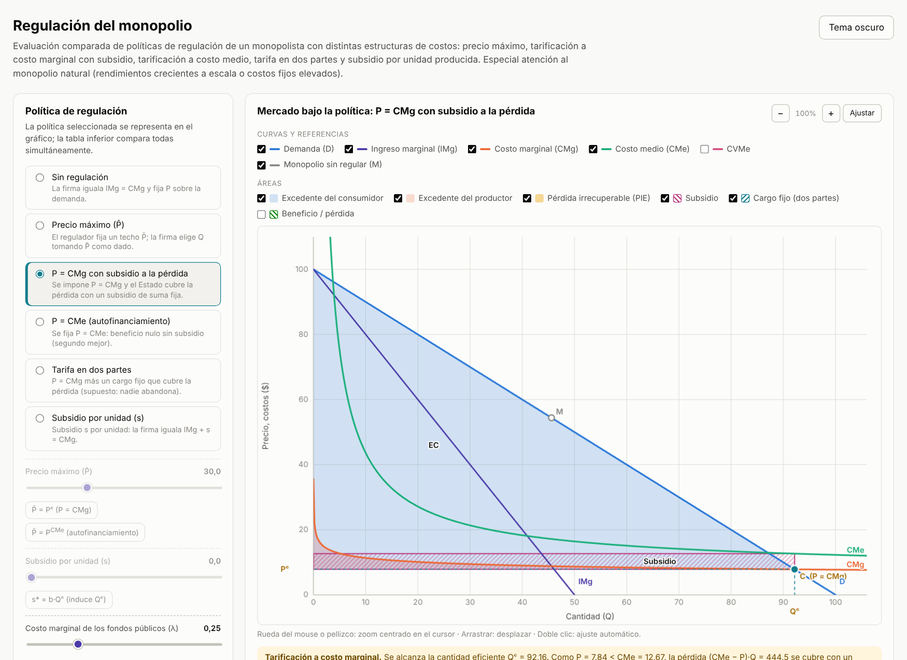
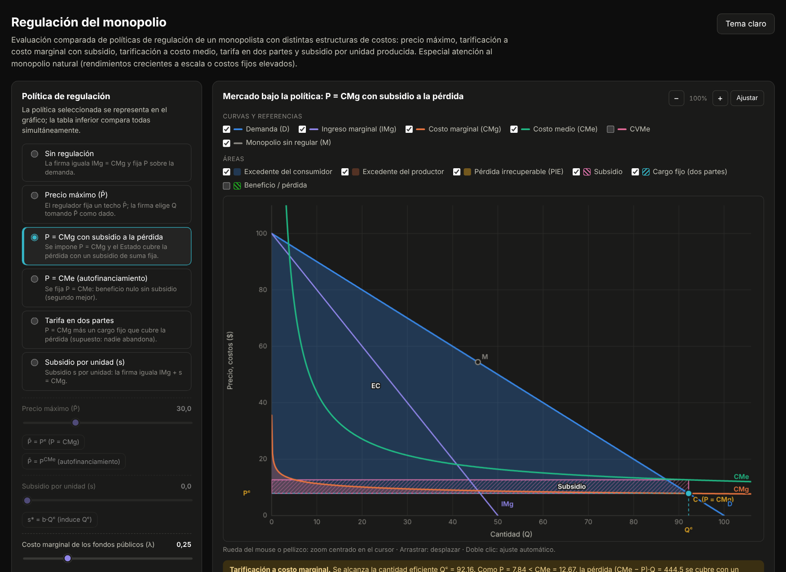

# Regulación del monopolio

Simulador interactivo, en un único archivo HTML autocontenido, para evaluar políticas de regulación de un monopolista cuya función de costos se deriva de distintas funciones de producción. Compara seis regímenes: monopolio sin regular, precio máximo, tarificación a costo marginal con subsidio, tarificación a costo medio, tarifa en dos partes y subsidio por unidad. Pone el foco en el monopolio natural. Es la continuación del simulador [Monopolio y estructuras de costos](https://fcontiggiani.github.io/monopolio-costos/monopolio_costos.html), con el que comparte el motor de costos. Material didáctico para Microeconomía Intermedia (Bloque 3: Monopolio; Bloque 5: Regulación económica).

**[▶ Abrir el simulador](https://fcontiggiani.github.io/regulacion-monopolio/regulacion_monopolio.html)**



<details>
<summary>Versión en tema oscuro</summary>



</details>

## Modelo económico

**Demanda y costos.** Demanda inversa lineal P(Q) = a − bQ. Las funciones de costo provienen de seis tecnologías: Cobb-Douglas y CES de largo plazo con grado de homogeneidad ν, Cobb-Douglas de corto plazo, Leontief, sustitutos perfectos y cúbica de corto plazo. A todas se suma un costo fijo adicional F. Por defecto se usa una Cobb-Douglas con ν = 1,2 y F = 300, que configura un **monopolio natural**: en la cantidad eficiente el precio igual al costo marginal queda por debajo del costo medio.

**Criterio de bienestar.** Con S como erogación fiscal y λ como costo marginal de los fondos públicos:

```
W = EC + π − (1+λ)·S = ∫₀^Q P(q) dq − C(Q) − λ·S
```

El **primer mejor** W\* corresponde a P = CMg, financiado sin distorsión. La pérdida irrecuperable de eficiencia de cada política se mide como PIE = W\* − W.

**Políticas evaluadas.**

| Política | Regla | Resultado típico |
|---|---|---|
| Sin regulación | IMg = CMg | Subproducción; PIE de monopolio |
| Precio máximo P̄ | IMg efectivo = P̄ hasta Q_d(P̄); la firma maximiza mín(P̄, P(Q))·Q − C(Q) | Con CMg creciente, P̄ = Pᶜ replica el óptimo; si P̄ < Pᶜ hay escasez. En un monopolio natural, P̄ = Pᶜ es inviable: el menor precio viable es P̄ = CMe |
| P = CMg con subsidio | Q = Qᶜ; subsidio de suma fija S = (CMe − P)·Q | Eficiencia asignativa; PIE = λ·S |
| P = CMe | Mayor Q con P(Q) = CMe(Q) | Autofinanciamiento (segundo mejor); subproducción moderada |
| Tarifa en dos partes | P = CMg más un cargo fijo total T = pérdida | Alcanza W\* si el cargo no excluye consumidores |
| Subsidio por unidad s | IMg + s = CMg; s\* = b·Qᶜ induce Qᶜ | Corrige la cantidad, pero la firma retiene la renta y el subsidio es costoso si λ > 0 |

**Supuestos.**
- El regulador tiene información completa sobre costos y demanda.
- Cuando hay escasez, el racionamiento es eficiente.
- En el corto plazo, el costo fijo r·K̄ + F es hundido: la firma opera si cubre el costo variable.
- En el largo plazo F es evitable: la firma opera si π ≥ 0.
- La tarifa en dos partes supone que ningún consumidor abandona el mercado. El simulador advierte cuando el cargo supera el excedente de los consumidores.

## Interfaz

| Control / panel | Función |
|---|---|
| Selector de política | Elige la política que se representa en el gráfico. También se puede elegir haciendo clic en una fila de la tabla comparativa |
| Precio máximo P̄ | Control deslizante, más los atajos «P̄ = Pᶜ» y «P̄ = P^CMe» |
| Subsidio por unidad s | Control deslizante, más el atajo «s\* = b·Qᶜ» |
| Costo de los fondos públicos λ | De 0 a 1; pondera el costo social de los subsidios |
| Tecnología, w, r, F, a, b | Igual que en el simulador de monopolio; cada tecnología conserva sus parámetros |
| Curvas | D, IMg, CMg, CMe y CVMe; punto M del monopolio sin regular y punto C del primer mejor |
| Áreas | EC, EP, PIE (por subproducción o por sobreproducción), subsidio (rayado), cargo fijo (rayado) y beneficio o pérdida |
| Gráfico | Zoom con rueda del mouse o pellizco, centrado en el cursor; desplazamiento por arrastre; doble clic o «Ajustar» restablece la vista |
| Resultados | Q, precio al consumidor y precio recibido por la firma, CMe, CMg, EC, EP, π, S, λ·S, cargo fijo, W, W\*, PIE y escasez |
| Tabla comparativa | Las seis políticas y el primer mejor, con barras de bienestar relativo y una nota que indica la política de mayor bienestar |
| Fundamentos analíticos | Sección plegable con la derivación de cada regla, incluida s\* = b·Qᶜ |
| Tema claro/oscuro | Sigue la preferencia del sistema; la elección se recuerda |

## Requisitos técnicos

- Archivo único `regulacion_monopolio.html` (HTML, CSS y JavaScript inline), sin bibliotecas externas ni CDN. Los gráficos usan Canvas 2D nativo.
- Funciona en navegadores modernos con JavaScript habilitado, sin conexión una vez descargado.
- `localStorage` se usa solo para el tema y está protegido con `try/catch`, para funcionar en iframes de Moodle.
- Diseño adaptable a pantallas angostas.

## Referencias

- Coase, R. H. (1946). The marginal cost controversy. *Economica*, 13(51), 169–182.
- Laffont, J.-J. y Tirole, J. (1993). *A Theory of Incentives in Procurement and Regulation*. MIT Press.
- Pindyck, R. y Rubinfeld, D. *Microeconomía*, cap. 10 (poder de mercado: monopolio).
- Varian, H. *Microeconomía intermedia*, cap. «Monopolio».

## Licencia y uso

Material desarrollado con fines exclusivamente didácticos. Los valores numéricos son ilustrativos. Se autoriza su uso, adaptación y redistribución con fines educativos, citando la fuente.
